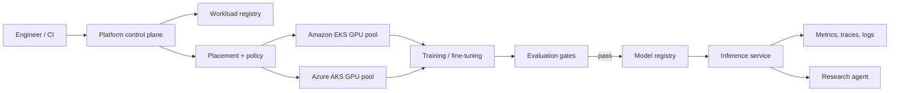

# Multi-Cloud AI Platform

A portfolio-grade platform for operating GPU workloads across AWS and Azure. It extends the parent research agent with the infrastructure and ML lifecycle capabilities needed for distributed training, parameter-efficient fine-tuning, evaluation, inference, and safe model promotion.

The project is deliberately local-first. Its control plane produces deterministic deployment plans without creating cloud resources; Terraform applies and GPU jobs remain explicit operator actions because they can incur significant cost.

## What this demonstrates

- A provider-neutral workload contract for training, fine-tuning, evaluation, and inference
- Placement on Amazon EKS or Azure AKS based on an explicit target and GPU requirements
- PyTorch/DeepSpeed and LoRA/QLoRA configuration as versioned data
- Quality gates before a model can move from candidate to production
- Kubernetes-native execution, observability, retries, and resource limits
- Terraform environments for reproducible AWS and Azure platform provisioning
- The existing sustainability research agent as the first inference/evaluation workload

## Architecture



## Quick start

Requires Python 3.12. From this directory:

```bash
python3.12 -m venv .venv
. .venv/bin/activate
python -m pip install -e ".[dev]"
pytest
ai-platform plan configs/qlora-smoke.yaml
```

`plan` only validates the workload and prints the Kubernetes/cluster requirements. It does not contact AWS or Azure.

## Delivery roadmap

1. **Control-plane MVP (included):** typed workload specification, policy checks, deterministic AWS/Azure placement plan, CLI, and tests.
2. **GPU execution:** EKS and AKS Terraform modules, NVIDIA GPU Operator/device plugin, Kueue, and one-node QLoRA smoke training.
3. **Distributed training:** multi-node PyTorchJob with EFA on AWS and InfiniBand-capable Azure SKUs; DeepSpeed ZeRO-3 checkpointing to object storage.
4. **Model lifecycle:** MLflow-compatible registry, reproducible dataset/model lineage, offline evaluation, approval gates, and rollback.
5. **Serving:** vLLM inference, autoscaling, canary deployment, SLO dashboards, and integration with the parent research agent.

See [architecture.md](docs/architecture.md) for design decisions and [skills-matrix.md](docs/skills-matrix.md) for how the milestones map to the job requirements.

## Cost and safety

GPU nodes default to zero desired capacity in infrastructure definitions. Use separate cloud accounts/subscriptions, budgets, quotas, workload identity, encrypted object storage, private networking, and short-lived credentials. Never commit cloud credentials or model-access tokens.
