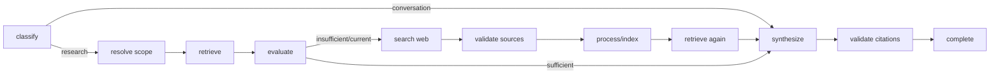
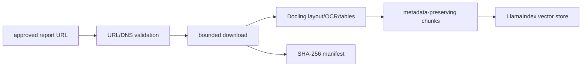

# Architecture

The implementation compacts validation and transient web processing around the search node because snippets are not persisted as reports. The loop counter is explicit state and is capped at two. Nodes perform one observable transition; state carries serializable question, routing, scope, evidence, attempts, and output. Retrieved pages are untrusted data and are placed only in the model's evidence section.

Ingestion is deterministic rather than agentic: network policy, parsing, chunk metadata, and deduplication need reproducible outcomes, not model discretion. Docling is primary and PyPDF is the lightweight fallback. Tables remain page-local and oversized tables are split by rows while retaining their headers and page metadata. LlamaIndex persists its document store, vector store, and index metadata; stable document IDs and checksums make repeated ingestion idempotent and changed reports replace their prior nodes.

Query retrieval combines semantic similarity with lexical overlap for exact ESG vocabulary. Company/year filters are applied inside each retrieval. Cross-company requests run one filtered retrieval per company and merge the groups round-robin before synthesis.
