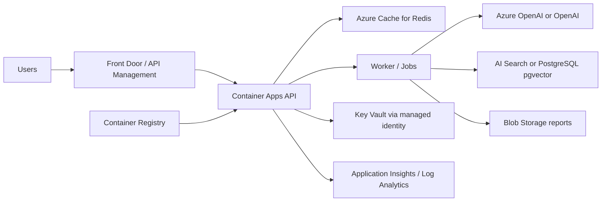

# Azure deployment

Azure Container Apps is the recommended starting point: the API, worker, UI, and optional MCP adapter are container workloads and do not initially justify AKS operational overhead. AKS becomes reasonable for custom networking, GPU-hosted models, or extensive platform standardization.

Build an immutable image in CI, scan it, push it to Azure Container Registry, and deploy by digest. Use a Container Apps environment with internal service discovery; expose only Front Door or API Management over TLS. Put Blob Storage, Redis, the index, and Key Vault behind private endpoints and private DNS. Workload managed identities receive narrowly scoped Blob, Key Vault, and search/database roles. Keep model credentials in Key Vault; Azure OpenAI can be added behind the existing LLM interface.

Move request state and rate-limit counters to Redis so replicas observe the same lifecycle. Queue long jobs using Service Bus or Container Apps Jobs. Store original reports and manifests in versioned Blob containers. Azure AI Search is the simplest managed hybrid index; PostgreSQL Flexible Server with pgvector is preferable when transactional metadata and vector search must share one store.

Autoscale API replicas on HTTP concurrency and workers on queue depth, retaining at least two production API replicas across availability zones where supported. Configure `/health` for liveness and `/ready` for readiness, termination grace periods, bounded retries with jitter, and idempotent checksum-based ingestion. Use rolling revisions with traffic splitting and automatic rollback on health/error thresholds.

Send structured request ID, stage, duration, dependency, and exception telemetry to Application Insights and Log Analytics using OpenTelemetry. Alert on 5xx rate, failed/stalled jobs, queue age, model/search latency, Redis pressure, index errors, and storage capacity. Do not log prompts containing sensitive material or credentials.

Enable Blob soft delete, versioning, lifecycle rules, geo-redundancy appropriate to recovery objectives, Redis persistence where required, and PostgreSQL point-in-time restore. Regularly test restore and regional failover. Front Door provides WAF and regional routing; API Management adds authentication, quotas, schema policies, and consumer analytics when a managed API boundary is needed. Restrict CORS to deployed UI origins.

Typical release commands are `az acr build --registry REGISTRY --image internet-search-agent:GIT_SHA .`, followed by a revision update with `az containerapp update --name APP --resource-group RG --image REGISTRY.azurecr.io/internet-search-agent:GIT_SHA`. Resource names, identities, private endpoints, and secrets should be provisioned in the organization's reviewed infrastructure repository rather than represented by incomplete templates here.

